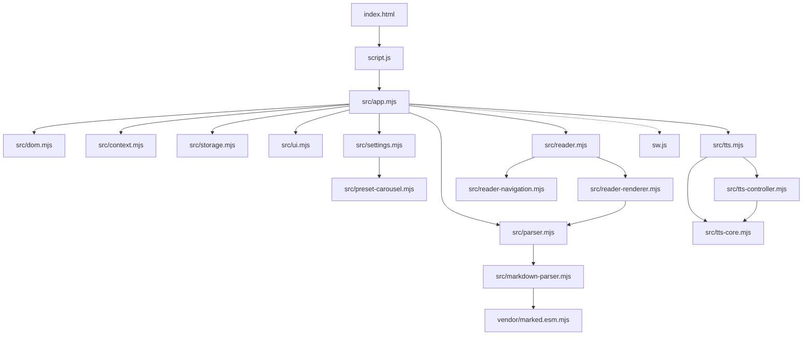

# Architecture Guide

Reader Webapp is a zero-build, zero-backend static web application composed of browser-native ES modules (`src/*.mjs`), a single stylesheet (`style.css`), a strict-CSP HTML shell (`index.html`), a vendored Markdown parser (`vendor/marked.esm.mjs`), and an offline app-shell service worker (`sw.js`).

## High-Level Module Graph

## Bootstrap & Shared Context

1. **`index.html`** loads `style.css` and defers `script.js`.
2. **`script.js`** acts as a lightweight compatibility entry point that dynamically imports `./src/app.mjs` and invokes `init()`, displaying an error banner in `#statusMessage` if initialization fails.
3. **`src/app.mjs`** guards initialization per document via a `WeakSet` (`initializedDocuments`) so a document is never initialized twice while unit tests can safely initialize distinct mock documents. It:
   - Collects DOM references via `collectElements()` (`src/dom.mjs`).
   - Builds the shared state/runtime container via `createAppContext()` (`src/context.mjs`).
   - Instantiates `ui`, `tts`, `parser`, `settings`, and `reader` with explicit dependency injection (avoiding global singletons).
   - Runs `cleanupLegacyBrowserStorage()` (`src/storage.mjs`) and registers `./sw.js` with `{ updateViaCache: 'none' }`.
   - Binds events and applies clean default values (`light` mode, preset `0` `Claude`, size `medium`, line height `1.85`, letter spacing `-0.015em`, margins `24px`, voice rate `1.0x`, `smartHeadings: true`).

### State Structure (`src/context.mjs`)

`createAppContext(els, doc)` separates state into two buckets:
- **`context.state`**: UI/interaction state (current text, active preset/mode, timers, carousel drag and swipe gesture tracking, `smartHeadings`).
- **`context.runtime`**: Operational state split into `runtime.reader` (`activeRenderId`, `lastActiveElement`) and `runtime.tts` (voices, word spans/metadata, chunk queue, playback state machine, timers, monotonic `speechGeneration`, mobile/support flags).

## Module Reference (`src/`)

| Module | Responsibility |
| --- | --- |
| `app.mjs` | Composition root, default initialization, and service worker registration |
| `constants.mjs` | Character limit (`1,000,000`), valid fonts/sizes/themes, `THEME_COLORS`, 20 presets (`lightPresets`, `darkPresets`), and TTS timing/chunk constants |
| `context.mjs` | Shared per-document `state` and `runtime` container |
| `dom.mjs` | Centralized DOM lookup (`collectElements`) |
| `markdown-parser.mjs` | Custom `Marked` instance, URL allowlisting, HTML escaping, heading ID slugification & deduplication, reserved ID protection, and smart heading heuristics |
| `parser.mjs` | Parser facade and `enforceExtractedTextLimit()` |
| `preset-carousel.mjs` | Preset track animation, drag physics, touch/mobile swipe gestures, and keyboard shortcut eligibility |
| `reader-navigation.mjs` | Mobile bottom sheet dialog semantics (`role="dialog"`, `aria-modal="true"`), focus trap, scroll lock, and viewport resize synchronization |
| `reader-renderer.mjs` | Asynchronous, frame-budgeted Markdown token rendering with render-ID cancellation |
| `reader.mjs` | View switching (`enterReader`/`goBack`), scroll progress bar, desktop toolbar auto-hide/hover lock, click-to-speak gating, and global keyboard handling |
| `settings.mjs` | Font, theme, `theme-color` meta sync, size, line height, letter spacing, responsive margin capping, and accordion section expansion |
| `storage.mjs` | Targeted removal of 16 legacy `reader_*` keys from `localStorage` and `sessionStorage` |
| `tts-core.mjs` | 190-character boundary chunking, voice deduplication/sorting/selection, and non-destructive DOM word tokenization |
| `tts-controller.mjs` | Web Speech API playback state machine, word highlighting, fallback estimation timer, desktop keep-alive, and page visibility/hide recovery |
| `tts.mjs` | Public facade re-exporting `createTTS` and `tts-core.mjs` helpers |
| `ui.mjs` | Status banners, loading overlay, polite `aria-live` announcer (`#liveAnnouncer`), and `inert`/`tabindex` focusability management |
| `utils.mjs` | `escapeHtml`, `formatError`, numeric/index clamping, `getElementTarget`, `getScrollTop`, capability-based `isMobileDevice`, and `cancelPendingRender` |

## Markdown Parsing & Security Pipeline

All pasted input flows through `enforceExtractedTextLimit()` (enforcing `MAX_EXTRACTED_TEXT_CHARS = 1_000_000`) and then `createMarkdownRenderer()` in `src/markdown-parser.mjs`:

- **Parser engine:** Uses vendored `marked` v15.0.12 (`vendor/marked.esm.mjs`) configured with `gfm: true`, `breaks: false`.
- **HTML neutralization:** The custom `html` renderer escapes raw HTML tokens with `escapeHtml()`, preventing script injection or arbitrary markup.
- **Link allowlist (`normalizeSafeLinkHref`):** Decodes HTML entities, trims whitespace, rejects ASCII control characters (`<= 0x1F`, `0x7F`), rejects protocol-relative URLs (`//...`), and only permits `http:`, `https:`, `ftp:`, `mailto:`, single-slash root-relative paths (`/...`), and fragment anchors (`#...`). Unsafe links render as plain anchor text; non-fragment links receive `target="_blank" rel="noopener noreferrer"`.
- **Image handling:** Markdown images render as `[Image: <escaped alt>]` so no external image requests occur.
- **Tables & task lists:** Tables are wrapped in `
` for horizontal scrolling; GFM task list items render disabled checkboxes.
- **Heading IDs & Smart Headings:**
  - Single-line standalone all-caps paragraphs (4–55 chars) are promoted to `<h2>` unless excluded by false-positive guards (e.g., `NOTE`, `WARNING`, `CAUTION`, `PLEASE`, `DO NOT`, `NOTICE`, or short acronym joins like `CPU AND GPU`).
  - Headings receive Unicode-aware slugified IDs deduplicated per document (`-1`, `-2`, …) and checked against `RESERVED_DOM_IDS` so user content can never collide with app-shell element IDs.
- **CSP defense-in-depth:** `index.html` declares `default-src 'self'; script-src 'self'; style-src 'self'; font-src 'self'; img-src 'self' data:; connect-src 'self'; object-src 'none'; base-uri 'self'; form-action 'none'`.

## Incremental Rendering & Concurrency

`src/reader-renderer.mjs` prevents UI freezes on large documents:

- Each `renderTextAsync()` call increments `runtime.reader.activeRenderId` and invalidates any previous TTS tokenization.
- Tokens are sliced and rendered incrementally via `insertAdjacentHTML('beforeend', html)` using a **12 ms** frame budget and a **30,000-character** per-frame cap, yielding via `requestAnimationFrame` (or `setTimeout(..., 0)` in non-browser environments).
- Every async step checks `renderId === runtime.reader.activeRenderId`. Calling `goBack()`, `clearText()`, or starting another render increments `activeRenderId`, immediately aborting in-flight work so stale DOM or callbacks cannot leak.

## Responsive Layout, Theming & Accessibility

- **20 Themes (`style.css` + `src/constants.mjs`):** All 10 light and 10 dark presets use CSS custom properties (`--bg`, `--card`, `--text`, `--text2`, `--accent`, `--on-accent`, `--toolbar-bg`, `--reader-text-color`) with `color-mix()` tinting, tested in `tests/test_regressions.js` for WCAG AA (`>= 4.5:1`) contrast. Applying a preset also updates `<meta name="theme-color">`.
- **Responsive breakpoints (`style.css`):**
  - **Desktop (`> 960px`):** 3-column grid settings drawer inside an auto-hiding fixed top bar (3.5 s idle timer, paused on pointer hover or keyboard focus, revealed on top-edge mouse move, tap, or `Tab`).
  - **Tablet (`641px–960px`):** 2-column settings grid with full-width theme/expanded sections.
  - **Mobile (`<= 640px`):** Floating action button (`#mobileFab`) toggles `#toolbar` as a modal bottom sheet (`role="dialog"`, `aria-modal="true"`) with scroll lock (`body.mobile-sheet-active`), backdrop dismissal, focus restoration (`runtime.reader.lastActiveElement`), and a keyboard `Tab`/`Shift+Tab` focus trap that includes the Close pill.
- **Focusability & Reduced Motion:** `ui.setContainerFocusable()` toggles both `inert` and saved `tabindex` values (plus `aria-hidden` on `#toolbar` and `#audioPlayerBar`) when bars are hidden. `@media (prefers-reduced-motion: reduce)` disables CSS transitions/animations, and TTS auto-scroll switches from `smooth` to `auto`.

## Text-to-Speech (TTS) Engine

The TTS subsystem is split into pure helpers (`src/tts-core.mjs`) and the stateful controller (`src/tts-controller.mjs`):

- **Lazy DOM Tokenization (`tokenizeReaderDOM`):** Runs only when narration starts or click-to-speak is triggered (never on initial document render). It uses a `TreeWalker` to wrap words in `` while preserving nested inline markup, ` ` boundaries, inter-word/trailing whitespace, and block separations (`\n\n`). Re-running tokenization unwraps existing `.tts-word` spans first so it is idempotent.
- **Click-to-Speak:** Gated by `isClickToSpeakEnabled()` (active only when TTS is playing/paused or the Speech settings section is expanded) and ignores active text selections, links, and buttons.
- **Chunking (`chunkText`):** Splits spoken text into chunks targeting `CHUNK_TARGET = 190` characters (avoiding browser utterance length/15-second drop limits), preferring sentence boundaries (`[.!?]`), then clause boundaries (`[,;:]`), then whitespace, and adjusting split points to avoid bisecting UTF-16 surrogate pairs.
- **Playback Concurrency:** Every start/restart/stop/mobile-pause increments `session.speechGeneration`; utterance callbacks (`onstart`, `onboundary`, `onend`, `onerror`) ignore stale generations.
- **Highlighting & Fallback:** Uses `utterance.onboundary` (`charIndex`) when supported, with an O(1) current/next-word fast path and binary search (`findWordIndexByChar`) for jumps. If a browser does not emit boundary events, a fallback timer (`BOUNDARY_FALLBACK_MS = 100`, `WORDS_PER_MIN = 180`) estimates progression.
- **Cross-Browser Resilience:**
  - Voice loading listens to `onvoiceschanged` and polls every `250ms` up to `5000ms`, deduplicating and sorting voices and matching the user's locale.
  - On desktop, a `10000ms` keep-alive calls `synth.pause(); synth.resume()` to work around Chromium speech stalls.
  - On touch-primary mobile devices (`isMobileDevice()`), pausing cancels the utterance and resuming restarts cleanly from `currentWordIndex`.
  - `visibilitychange` and `pagehide` pause active playback; if hidden for more than `15000ms`, pending speech is canceled and marked for clean word-index restart on resume.

## Service Worker & Storage Isolation

### Service Worker (`sw.js`)

- **Atomic precaching (`install`):** Precaches all 27 `APP_SHELL` URLs into `CACHE_NAME` (`reader-webapp-shell-v13`) with `{ cache: 'reload' }` and calls `self.skipWaiting()`.
- **Cache cleanup (`activate`):** Deletes stale caches matching `reader-webapp-*` and calls `self.clients.claim()`.
- **Fetch strategies:**
  - **Canonical navigations (`./`, `./index.html`):** Network-first (`cache: 'no-cache'`), mirroring successful responses under both `ROOT_URL` and `INDEX_URL`, falling back to the cached app shell when offline or when a non-OK response occurs.
  - **Canonical app-shell assets:** Stale-while-revalidate (serves cached asset immediately while refreshing in the background via `event.waitUntil()`).
  - **Everything else:** Passes through to the network untouched.

### Legacy Storage Cleanup (`src/storage.mjs`)

Reader Webapp stores no user content or preferences in browser storage. On startup, `cleanupLegacyBrowserStorage()` deletes only 16 explicitly listed legacy `reader_*` keys from `localStorage` and `sessionStorage`, catching access or quota errors independently per storage area and preserving all unrelated keys on the same origin.
